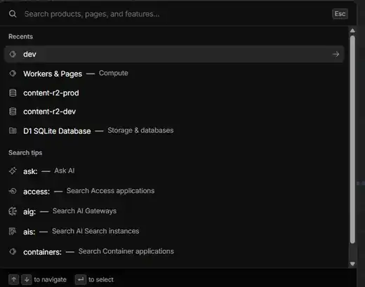

# ALEXEEV Studio — visual direction and mockup reference pack

> **Status:** design direction / implementation reference, not a pixel-perfect product specification.
>
> **Owner direction, 07.10.2026:** Cloudflare Dashboard is the primary visual and UX orientation for ALEXEEV Studio: calm operational dark UI, high information density, stable layouts, structural skeletons, compact controls, collapsible navigation and data-first pages.
>
> The product model, API capabilities, security rules and the current master plan remain authoritative. Mock data in reference images is illustrative only.

## 1. Why this document exists

ALEXEEV Studio should be designed as one coherent working tool before more product screens are implemented. The references in this directory define the visual language, recurring interaction patterns and target page compositions so frontend work does not redesign each screen independently.

The goal is **not to copy Cloudflare branding or reproduce its product**. We use Cloudflare Dashboard as a reference for:

- information density and hierarchy;
- restrained dark surfaces and thin borders;
- compact navigation, tabs and controls;
- tables as primary working surfaces;
- right-side inspectors and contextual detail;
- collapsible panels and navigation;
- skeletons that match the final geometry;
- charts embedded into operational layouts;
- global search / command-palette behavior;
- calm motion and stable page dimensions.

ALEXEEV keeps its own identity, product terminology, typography, content workflows, Telegram semantics and Dota-specific information architecture.

## 2. North-star visual style

The target is **Calm Operations / restrained Cloudflare-like dark**.

Avoid the earlier “neon dashboard” tendency. Generated mockups in the reference board intentionally explore ideas, but their saturation is **not** the final color target.

### Visual rules

- Background and most surfaces are neutral/cool dark, not blue-glowing.
- Accent appears on roughly **<5% of the visible UI**: primary action, focus, selected item, selected chart series and important links.
- No decorative glow around cards, buttons or the logo.
- No large gradients.
- Borders are thin and do most of the structural work.
- Panels are visually quiet; content carries the hierarchy.
- Status colors are muted and semantic: success, warning, failed, unknown, informational.
- Charts use lower-chroma colors and readable contrast rather than saturated neon lines.
- Selected rows may have a subtle tinted background plus a narrow accent edge.
- Hover should be visible but not flashier than the selected state.
- Focus ring must be accessible without producing a “border inside a border” effect.
- Rounded corners remain restrained. Working tables and panels should not look like a wall of floating cards.

### Density

Desktop is a professional work surface:

- sidebar: approximately 216–224 px expanded;
- sidebar: approximately 56–64 px collapsed;
- desktop controls: approximately 34–36 px;
- dense table rows: about 44–48 px depending on content;
- mobile/touch targets: at least 44 px;
- operational screens use available width;
- document/editor screens constrain the writing column and use an inspector/preview beside it.

## 3. Reference images

The exploratory board below collects concepts already discussed for Overview, Posts, Editor, Publications, Incidents, Analytics, Calendar, Media, Automations and Mobile.


These are **references**, not implementation screenshots. They can include fields, metrics or content that are not implemented yet.

The Cloudflare-like search palette reference is stored separately:



See [references/README.md](./references/README.md) for the reference policy.

## 4. Application shell

### Desktop sidebar

Use a persistent left sidebar similar in behavior to Cloudflare:

- expanded mode shows icon + label;
- collapsed mode becomes a compact icon rail;
- the **collapse/expand arrow is fixed at the bottom of the sidebar**;
- collapse/expand is animated with restrained motion and must not reload the route;
- active navigation uses a small accent mark and a subtle background, not a large bright fill;
- badges may show actionable counts (for example incidents), but should not become decorative counters everywhere;
- nested navigation is allowed when it materially improves discoverability;
- maximum nesting in the sidebar is **two levels**;
- anything deeper becomes page tabs, segmented controls, sub-navigation or inspectors.

Suggested top-level product areas as they exist or are built:

- Обзор
- Посты
- Публикации
- Инциденты
- Аналитика
- Календарь
- Медиа-библиотека
- Dota / Dota Pulse
- Источники
- Автоматизации
- Настройки

Do not expose empty navigation items merely because they exist in a future plan. A future area can appear in mockups marked **Preview**, but product navigation should expose it only when the route has useful behavior.

### Top bar

The top bar can contain:

- global search trigger;
- DEV/production environment context where needed;
- timezone/date context;
- compact service health;
- appearance/theme control;
- owner menu.

Keep it thin. It is utility navigation, not a second dashboard.

## 5. Global search / command palette

The Cloudflare search interaction is a strong reference.

### Entry points

- persistent search field in the top bar;
- keyboard shortcut: Ctrl/Cmd + K;
- on mobile: search icon opens a full-screen sheet.

### Palette structure

1. Search input.
2. **Recents** when query is empty.
3. Grouped results when typing:
   - Posts
   - Publications
   - Incidents
   - Dota events
   - Sources
   - Media
   - Automations
   - Settings
4. Muted context per row: entity type, status, destination/source or date.
5. Footer keyboard hints:
   - ↑ / ↓ navigate
   - Enter open
   - Esc close

Example:

```text
Поиск постов, публикаций, событий...

Недавние
  Новый сундук и наборы              → Публикация
  Patch 7.37d                        → Dota event
  Telegram rate limit               → Инцидент

Посты
  Изменения героев                   Черновик · 2 ч назад

Публикации
  VALVE РЕШИЛИ ЗАБРАТЬ...            Отправлено · Test канал

Источники
  Valve patch notes                  Доступен
```

Search should primarily **navigate**, not become a hidden mutation console. Destructive actions are performed in the destination screen with normal safeguards.

Deep-link to exact objects where possible so browser reload/back/forward preserves context.

## 6. Loading and structural skeletons

This is a high-priority design rule.

**Loading must preserve the geometry of the final page.**

Bad:

```text
small loader → request completes → page suddenly grows by 500 px
```

Target:

```text
final panel geometry
┌────────────────────────────┐
│ skeleton header            │
├────────────────────────────┤
│ skeleton row               │
│ skeleton row               │
│ skeleton row               │
└────────────────────────────┘
          ↓
same geometry with real data
```

Rules:

- tables skeletonize the real number/shape of visible columns;
- chart skeletons keep the same chart height, header and legend area;
- an inspector skeleton keeps the same width as the loaded inspector;
- cards/panels keep their expected minimum height;
- lists use realistic row skeletons rather than generic grey blocks;
- partial loading should not blank the whole route;
- a failed sub-panel shows its own error state while other data remains visible;
- ordinary authenticated reload should show the application shell and route skeleton while the session refreshes, not a full-screen “Проверяем вход…” splash.

## 7. Panels, cards and nested blocks

Panels should behave more like Cloudflare sections than decorative dashboard cards.

Use:

- thin border;
- quiet surface;
- compact header;
- optional count/status next to title;
- contextual action on the right;
- collapse/expand when useful;
- stable height where possible.

### Inline problem state

If one panel becomes stale or fails, prefer a compact inline notice inside that block:

```text
Источники                              ⚠ 1 проблема
────────────────────────────────────────────────────
Valve API        доступен
Dota news        данные не обновлялись 47 мин · Повторить
OpenDota         доступен
```

Do not replace an entire page with one generic error banner.

## 8. Working tables

Tables are one of the core ALEXEEV patterns.

### Media is optional

Rows must be equally intentional when they have:

- image;
- video;
- GIF;
- multiple media;
- **no media at all**.

A text-only row uses a restrained type icon or no thumbnail column depending on the table. It must not look like an image failed to load.

### Common capabilities

Depending on the page:

- search;
- quick view presets;
- filters;
- sortable columns;
- period/date range;
- pagination;
- row selection;
- bulk actions only when meaningful;
- active-row highlight;
- row action menu;
- right-side inspector;
- URL-backed filter/search/open-row state.

Potential later enhancements:

- column chooser;
- saved views;
- compact/comfortable density;
- expandable rows;
- mini sparklines in metric-heavy tables.

### Publication filter example

```text
Все · Сегодня · Запланированные · Отправленные · Ошибки

[ Поиск по заголовку и тексту... ]

Статус        Канал          Тип контента       Период        Сортировка
Все           Все каналы     Все                7 дней        Сначала новые
```

Metrics may also be filterable **when those metrics actually exist**:

- views >= N;
- engagement range;
- reactions/reposts;
- publication age;
- platform/channel.

Do not fabricate unavailable Telegram metrics just to fill the design.

## 9. Inspector / detail rail

Desktop data screens should often use a right-side inspector.

Behavior:

- selected row remains visible and highlighted;
- inspector opens without navigating away from the list when possible;
- width is stable;
- can be collapsed/closed;
- route/search params encode the selected entity where useful;
- mobile becomes a full-screen sheet or bottom sheet depending on content depth.

Common tabs:

- Контент / Детали
- Статистика
- Логи
- Связанные

Only show a tab when its data exists or the mockup clearly marks it as future/Preview.

## 10. Page direction

### Overview

A decision center, not a KPI wall.

Target composition:

- 3–4 compact summary signals;
- “Требует внимания”;
- Today / upcoming publications;
- recent publications;
- Dota Pulse;
- channel analytics summary when real data exists;
- service/source health;
- stable grid and structural skeletons.

Dashboard cards should deep-link to the relevant filtered data, not all go to the same generic list.

### Posts

Database/table first.

Columns can include:

- post/title;
- media/type;
- status;
- changed;
- revision/version;
- author/tags when supported.

The page should look good with mixed content: text-only, image, GIF and video.

Right inspector can expose:

- content preview;
- media;
- revision;
- tags;
- publication links;
- quick actions.

### Post editor / creation

Desktop:

- document editor on the left;
- Telegram preview/inspector on the right;
- clear save/autosave state;
- publication actions stay visible but not dominant.

Media block must support **both**:

1. **Загрузить новые файлы**
2. **Выбрать из медиа-библиотеки**

Manual media is multi-file:

- images;
- videos;
- GIFs;
- reorder;
- remove;
- replace;
- preview compatibility.

A post may have no media. Text-only is a first-class workflow.

Preview can offer:

- with media;
- text only;
- compact preview.

Mobile editor uses one-row primary formatting actions and a bottom sheet for rare formatting instead of wrapping the desktop toolbar into several rows.

### Publications

Operational control surface:

- quick presets;
- search;
- status/channel/type/date filters;
- dense table;
- optional media;
- selected publication inspector;
- pagination;
- contextual safe actions.

Inspector can contain:

- Details/Content;
- Statistics **only when collected**;
- Logs/attempts;
- Related items.

Overview deep links should open the matching preset or exact publication.

### Incidents

Operations page:

- Open / Needs review / Errors / Closed presets;
- severity/status/source filters;
- last seen;
- source/module;
- affected object;
- inspector with error details and linked publication/job/source;
- retry/snooze/resolve where safe;
- recovered state.

Technical alerts go through the **owner Telegram bot private chat**, never a public/test content destination.

### Analytics

Closest in composition to Cloudflare Metrics:

- compact metric strip;
- one primary chart answering a specific question;
- top posts/ranked table;
- secondary charts below;
- period and destination filters;
- stable chart skeletons.

Future deterministic same-age comparisons are appropriate. No AI interpretation.

### Calendar

Month / Week / Day / List.

- dense calendar grid;
- compact event chips;
- thumbnail only when it helps;
- status/type is encoded with a small semantic marker;
- right agenda/inspector for selected date;
- timezone always explicit where ambiguity matters;
- filters/layers can include publication, draft, incident or Dota event context;
- reschedule/cancel safeguards apply.

### Media Library

- grid/list switch;
- search;
- type/usage/date/tag filters;
- storage usage;
- images, video, GIF and other supported assets;
- detail inspector with metadata and where-used links;
- action to insert selected media into a post.

The Media Library is the reusable source for the editor. Do not force re-uploading assets that already exist.

### Sources / Dota Intelligence

Dota Intelligence is deterministic, not AI-based.

Potential views:

- event feed;
- source health;
- patches;
- heroes;
- items;
- treasures/cosmetics;
- watchlists;
- observed stat movers.

Official facts and third-party statistics must retain source/provenance and timestamps.

### Automations / Cron

Cron schedules must be inspectable in the product instead of being hidden in infrastructure.

Recommended Automations page:

| Column | Meaning |
|---|---|
| Name | Human-readable task |
| Cron | Expression + human label |
| Purpose | What it does |
| Source | Telegram / Valve / stats / DB / internal |
| Next run | Exact local time + relative time |
| Last run | Result + timestamp |
| Duration | Latest execution time |
| Status | enabled / paused / failed / running |
| Toggle | Enable/disable with safeguards |

Inspector tabs:

- Overview
- Logs
- Settings

Details may include:

- retry policy;
- timeout;
- last/next run;
- source;
- notifications;
- linked section;
- run history.

Useful lower panels:

- publication queue health;
- source health;
- recent executions.

Settings may link to Automations, but Cron visibility should not live **only** inside Settings.

### Settings

Master/detail pattern.

Potential sections as implemented:

- Channels
- Appearance
- Owner notifications
- Timezone/defaults
- Integrations/health links

Do not expose raw secrets.

## 11. Mobile direction

Mobile keeps the same product capability but changes composition.

Use:

- bottom navigation for primary destinations;
- “Ещё” for secondary destinations;
- inspectors become full-screen sheets;
- dense desktop tables become purposeful mobile rows/cards;
- no horizontal desktop table squeezed into 320–390 px;
- 44 px minimum touch targets;
- editor toolbar is compact;
- media picker becomes a dedicated mobile sheet/page;
- Calendar defaults to a useful day/week agenda when month view becomes too dense;
- global search opens full-screen.

Required mobile mockups are listed in [MOCKUP_MATRIX.md](./MOCKUP_MATRIX.md).

## 12. Three layout approaches and how to use them

### A. Calm Operations — default

Cloudflare-first.

**Pros**
- strongest readability for daily use;
- calm over long sessions;
- scales well as product grows;
- ideal for tables, operations, incidents, cron and settings;
- skeleton/loading patterns are straightforward.

**Cons**
- deliberately less “wow”;
- ALEXEEV identity must come from typography, content and a restrained accent rather than decoration.

**Decision:** this is the product base.

### B. Data-rich Analytical — selective

Use on Analytics, Dota statistics and system/automation health.

**Pros**
- high information density;
- comparisons, trends and operational signals fit naturally;
- useful for expert workflows.

**Cons**
- can overwhelm when used everywhere;
- mobile needs aggressive reprioritization;
- too many metrics can turn Overview into a wall of numbers.

**Decision:** layer this on top of A only where data justifies it.

### C. Content-first / Media-rich — selective

Use on Posts, Media and Editor.

**Pros**
- excellent for visual content workflows;
- media selection and preview are faster;
- inspector works well for editorial context.

**Cons**
- thumbnails can dominate;
- poor fit for text-only content if forced everywhere;
- inconsistent density if media/no-media layouts are not designed together.

**Decision:** use media conditionally inside A, never as a separate unrelated visual language.

## 13. Scope guard: no AI product functionality now

AI/LLM functionality is currently out of scope.

Some old exploratory screenshots may accidentally contain labels such as AI moderation, OpenAI API, generation or similar concepts. Those labels are **not requirements** and must not be implemented from a mockup.

Current product behavior should rely on deterministic APIs, parsers, rules, thresholds, schedules and manual workflows unless the owner explicitly reintroduces AI scope later.

## 14. Implementation relationship

These references guide composition and UX, but the implementation source of truth remains:

- `apps/frontend/src/app/styles/tokens.css`
- `apps/frontend/src/shared/ui`
- route/page code
- product/API contracts
- the master implementation plan

When a mockup conflicts with real platform capability or security, product correctness wins.

When an older visual document conflicts with this 07.10.2026 direction, **this document wins for visual mood, density and loading behavior**.
